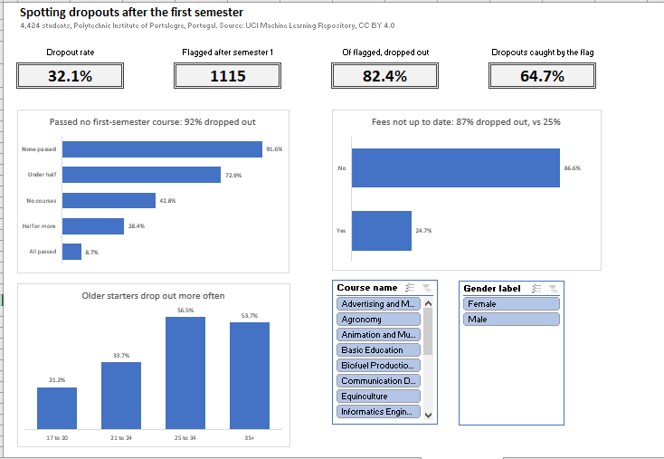
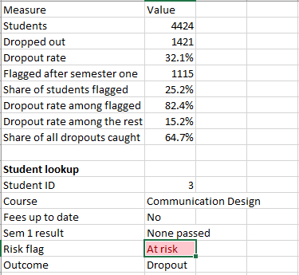

# Spotting student dropouts after the first semester (Excel)

**A two-part rule applied after the first semester (tuition fees not up to date, or fewer than half of first-semester courses passed) flags 25% of students and catches 65% of all those who drop out. 82% of flagged students dropped out, against 15% of everyone else.**

**Tools:** Excel (Power Query, structured references, INDEX/MATCH, nested IF, COUNTIFS and AVERAGEIFS, PivotTables, PivotCharts, slicers, data validation, conditional formatting)

**Data:** [Predict Students' Dropout and Academic Success](https://archive.ics.uci.edu/dataset/697/predict+students+dropout+and+academic+success), UCI Machine Learning Repository (Realinho et al., 2021), CC BY 4.0; 4,424 students of the Polytechnic Institute of Portalegre, Portugal

**Workbook:** [`student_dropout.xlsx`](student_dropout.xlsx) | **Dashboard:** [`student_dropout_dashboard.pdf`](student_dropout_dashboard.pdf)

---

## Business question

Can a university spot the students who will drop out using only what it knows after their first semester, early enough to offer help?

## Findings

Overall, 1,421 of 4,424 students (32.1%) dropped out.

| Factor | Group | Students | Dropout rate |
| --- | --- | --- | --- |
| First-semester courses passed | None | 538 | **91.6%** |
| | Fewer than half | 310 | 72.9% |
| | Half or more (not all) | 1,668 | 28.4% |
| | All | 1,728 | 8.7% |
| | Not enrolled in any | 180 | 42.8% |
| Tuition fees up to date | No | 528 | **86.6%** |
| | Yes | 3,896 | 24.7% |
| Scholarship | No | 3,325 | 38.7% |
| | Yes | 1,099 | 12.2% |
| Age at enrollment | 17 to 20 | 2,551 | 21.2% |
| | 25 to 34 | 697 | 56.5% |

### 1. The first semester already tells most of the story

Students who passed none of their first-semester courses dropped out 92% of the time; those who passed all of them, 9%.

### 2. Unpaid fees are the second warning sign

87% of students whose fees were not up to date dropped out, more than three times the rate of those who had paid (25%).

### 3. Age and course matter too

Students who started at 25 to 34 dropped out at 57%, against 21% for those who started at 17 to 20. By course, dropout ranged from 15% in Nursing to 54% in Informatics Engineering and 55% in Equinculture.

## Early-warning rule

A student is flagged after semester one if their tuition fees are not up to date, or they passed fewer than half of the first-semester courses they enrolled in.

| Measure | Value |
| --- | --- |
| Students flagged | 1,115 (25.2%) |
| Dropout rate among flagged | 82.4% |
| Dropout rate among the rest | 15.2% |
| Dropouts caught by the flag | 919 of 1,421 (64.7%) |

Only 37 flagged students went on to graduate, so support aimed at this group would rarely be wasted.

## Recommendation

Run the rule at the end of every first semester and contact each flagged student within weeks, not at the end of the year: the finance office for those behind on fees (a payment plan or hardship fund) and an academic adviser for those who failed most of their courses.

The rule misses about a third of dropouts (502 students). They are more often older starters (30% started at 25 or over, against 19% of all unflagged students) and less often scholarship holders, so adding age and scholarship status is the next step to catch more of them.

## How the workbook is built

| Sheet | What it does |
| --- | --- |
| Read me | Question, source, sheets, rule and limitations |
| Data | Raw file imported with Power Query (semicolon-separated, hidden tab in one header fixed, 14 of 37 columns kept, student ID added), plus calculated columns: course name (INDEX/MATCH), dropped (1/0), first-semester pass rate and result band, age band, fees, scholarship and gender labels, risk flag |
| Courses | Lookup table from course code to course name |
| Analysis | PivotTables of student count and dropout rate (average of the 1/0 column) by each factor |
| Early warning | COUNTIFS and AVERAGEIFS summary of the rule, and a student lookup with data validation and conditional formatting |
| Dashboard | KPI cards, three PivotCharts and slicers for course and gender |
| Chart data | The PivotTables behind the dashboard charts |

## Limitations

- One institution in Portugal; patterns may differ elsewhere.
- All 180 students with no first-semester courses recorded are in Animation and Multimedia Design, and 75 of them graduated, so the "Not enrolled in any" group most likely reflects missing records for that course rather than students who took no courses.
- Students still enrolled at the end of the normal course length may yet drop out, so the dropout rate is a minimum.
- Associations, not causes: unpaid fees may signal money problems that also lead to dropout.
- The rule uses the first semester only. A model could do better, but this rule fits on a sticky note and anyone can apply it.

## How to rebuild it

See [GUIDE.md](GUIDE.md). The raw data is in `data/raw/data.csv` and the course names in `lookups/course_names.csv`.

---

Olorunmaiye Peter | [Portfolio](https://ayanfedara.github.io)
